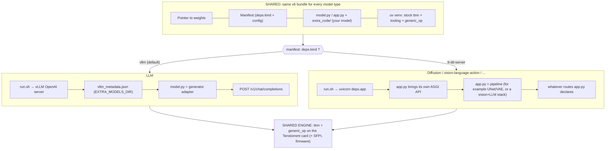

<!-- SPDX-License-Identifier: Apache-2.0 -->
<!-- SPDX-FileCopyrightText: 2026 Tenstorrent USA, Inc. -->
# Thin (v6) model packages

> **Status: runnable today.** This page is the design and `deps`-schema reference. **How to build
> one** — the canonical layering, the steps, and the checks — is
> [E2E_RECIPE_V6.md](E2E_RECIPE_V6.md); agents follow the `tt-model-thin-package` skill. In short:
> **stock `ttnn`** from PyPI, tt-transformers as **tooling only**, the **model's own code shipped in
> the bundle** (`extra_code/`), and custom kernels only as **`generic_op` wheels**.
>
> An earlier revision of this page planned for a thin bundle to pin one **models wheel**,
> `tt-metal-models` ([`tt-metal#54478`](https://github.com/tenstorrent/tt-metal/pull/54478)), which
> packages the *whole* `models/` tree. That is no longer the recommended shape: it ships every
> other model's code with yours (thousands of files to run a few dozen), and tt-transformers is
> becoming tooling only, with models living with their own bundles. Do not build a `tt-metal-models`
> wheel to make a thin bundle work.

A **thin (v6) bundle** keeps the self-contained boundary between models (its own uv-managed venv)
but builds that venv from **pip dependency pins plus bundled wheels**, with the model's code
shipped in the bundle, instead of embedding the full platform. There is **no embedded or forked
`ttnn` wheel and no `metal/` tree**.

## What a thin bundle contains
```
<org>/<model>/
  tt_kernel_manifest.json     # schema_version "6"; carries a `deps` block (below)
  model.py                    # the entry point; `--main-class model:Class` resolves it (PYTHONPATH=$HERE)
  requirements.txt            # pip pins: stock ttnn (+ torchvision). No index options in this file
  constraints.txt             # fully resolved pins applied to every install step (--constraints)
  vllm-overrides.txt          # numpy<2 / opencv pins for the empty-target vLLM build (see below)
  wheels/                     # bundled wheels installed BY PATH: vllm-tt-plugin (the vLLM integration),
                              # any generic_op custom-op wheel, a tooling-only tt-transformers wheel
                              # (until it publishes) [+ optional prebuilt vLLM wheel]
  extra_code/                 # the model's own code (and any pure-Python ops), first on PYTHONPATH (issue #127)
  vllm_models/<name>/vllm_metadata.json   # EXTRA_MODELS_DIR contract (arch -> main_class)
  install.sh  run.sh
  # weights: NOT embedded. Hugging Face (HF) pointer in the manifest
```

## Manifest `deps` block (schema 6)
- `python`: pinned interpreter (uv provisions it into the bundle)
- `requirements`: the pins file (default `requirements.txt`): stock `ttnn` and what the venv needs from
  an index. **No index options** (`--extra-index-url` and the like) — pip and uv honour them inside the
  file, and they re-rank indexes for the whole resolve (see Install / serve)
- `constraints`: optional fully resolved pins applied to every dependency-resolving install step
  (`--constraints`). Treat it as required: it is what turns an index-ranking problem into a loud
  failure instead of a silent downgrade
- `wheels`: bundle-relative wheels installed **by path** (`vllm-tt-plugin`, then any `generic_op` wheels)
- `wheels_dir`: the dir holding them (`wheels`), also put on `--find-links`
- `custom_ops`: bundle-relative paths of the shipped `generic_op` wheels `model.py` actually
  **imports**, auto-recorded at package time, so you never hand-maintain the list. Metadata only
  (discovery/provenance): a subset of `wheels`, it does **not** drive installation, and how you
  ship/import ops is unchanged (`--ops-wheel` still installs by path). Omitted from the manifest
  when empty. What counts as a custom op, and what detection does not see:
  - **Only `--ops-wheel` wheels are scanned.** A `--models-wheel` (or the plugin wheel) is never
    a candidate, so a bundle that ships its model code only via `--models-wheel` records none.
  - **Only wheel-shipped ops count.** Pure-Python op code shipped in the bundle as source rather
    than as a wheel (for example an `--extra-code` tree) is not recorded, even when `model.py`
    imports it.
  - A wheel matches by the top-level packages it provides. The tt-metal platform and models names
    (`models`, `ttnn`, `tt_lib`, `tt_metal`, `tracy`) never count, so a models wheel passed as
    `--ops-wheel` is not recorded just because `model.py` does `from models...`. `tt_transformers`
    is **not** on that list: if you ship the tooling-only tt-transformers wheel via `--ops-wheel`,
    do not import `tt_transformers` in `model.py`, or it is recorded as a custom op.
  - **Only `model.py` is scanned**, statically. An import in a helper module, a dynamic import
    (`importlib.import_module(...)`, `__import__`), or an op reached only by
    `ttnn.generic_op("name", ...)` with no Python `import` is not detected (still shipped and
    served, just not listed).
- `vllm`: the empty-target vLLM install step (below): `version`, `target_device` (`empty`),
  `overrides` (the pins file), `common_requirements` (optional bundled copy, else fetched),
  `wheel` (optional prebuilt empty-target wheel). `None` for a non-vLLM model.
- `model_dir`: where `model.py` lives (default the bundle root), used as PYTHONPATH at serve
- `extra_code_dir`: a shipped tree of **pure-Python** code — the model's own package, and any
  hand-written ops that compose stock `ttnn` — staged under `extra_code/` and put on PYTHONPATH
  **ahead of** `model_dir` so `import <pkg>` resolves (`--extra-code <dir>`). This is where a
  model's code lives in the canonical shape, rather than inside tt-transformers. Custom kernels go
  in a `generic_op` wheel (`--ops-wheel`). For a new registered C++ `ttnn` op or a forked build,
  stay on v5/v5.1.
- `verify`: `python -c` statements run at the end of `install.sh`, after the venv is built
  (`--verify <stmt>`, repeatable) — sanity-import the shipped tree, or assert the `ttnn` version it
  was validated against (the installed `ttnn` is only concrete post-install). A failing check fails
  the install.

## Install / serve
`install.sh` builds the venv with uv (`uv venv --relocatable --python <pin>`), then installs in
this order. The order matters:

1. **Engine**: `uv pip install -r requirements.txt` (stock `ttnn`). This lands `torch` and `numpy<2`
   FIRST so vLLM's deps resolve against them. `torch` must be the CPU build, so this step adds the
   PyTorch CPU index.

   The CPU index is scoped to the torch family with uv's `--torch-backend cpu` (uv 0.6.9 or newer;
   `install.sh` stops with a clear message on an older uv). Every other package, `certifi`, `requests`,
   `urllib3` and `idna` included, resolves from PyPI, so `--constraints` and wider dependency closures
   work in this step. (Earlier versions used `--extra-index-url`, which made uv take those packages
   only from the CPU index at 2022 versions. Bundles staged by those versions keep the old
   `install.sh`; restage them.)
2. **vLLM core (empty target)**: this is **not** a pip pin. It is **stock upstream vLLM built with
   `VLLM_TARGET_DEVICE=empty`** (NOT the CUDA `vllm` on PyPI), exactly mirroring the plugin's
   [`docs/install-vllm-tt.sh`](https://github.com/tenstorrent/vllm-tt-plugin/blob/main/docs/install-vllm-tt.sh):
   - `uv pip install --override vllm-overrides.txt -r <vLLM v0.25.1 common.txt>`. The overrides pin
     `opencv-python-headless==4.11.0.86` and `numpy>=1.24.4,<2` so ttnn's `numpy<2` is not bumped
     (opencv is vLLM's only numpy-2 puller and no Tenstorrent-registered model uses its video
     path). The upstream `common.txt` is fetched from the pinned tag unless a copy is bundled.
   - `VLLM_TARGET_DEVICE=empty uv pip install --no-deps --no-binary vllm vllm==0.25.1` builds vLLM
     from source. (Or, if a prebuilt empty-target wheel is bundled, `uv pip install --no-deps <wheel>`.)
   The `tt` platform is supplied by the plugin at runtime. `VLLM_TARGET_DEVICE` is a **build-time**
   var only and is not set at serve.
3. **Plugin and custom ops**: `uv pip install [--find-links wheels] <vllm-tt-plugin + generic_op wheels>`,
   installed by path AFTER vLLM. The plugin's `pyproject` omits `vllm`, so this step
   does not re-resolve or clobber the empty-target build.

`run.sh` wires the engine env (`LD_PRELOAD` of `_ttnncpp.so`, `TT_METAL_HOME` at the installed
`ttnn`, `EXTRA_MODELS_DIR`, hermetic caches under the folder) and launches vLLM with
`PYTHONPATH=$HERE` so `model.py` imports. `tt-model pull` and `serve` route a thin bundle through
the generated `install.sh` and `run.sh`.

> **Why vLLM is built at install rather than pinned:** the plugin runs against a vLLM compiled for an *empty* device
> target so it can inject the `tt` platform out-of-tree. The PyPI `vllm` wheel is CUDA-built and
> would break that. A resolvable `vllm` pin anywhere (requirements, or the plugin's own deps) would
> silently uninstall the empty build and pull the CUDA wheel. That is why the plugin's `pyproject`
> omits `vllm` and why vLLM is installed in its own `--no-deps` step.

> **On `run.sh`:** the serving launcher is a generated `run.sh`, and `tt-model serve` runs
> `bash <bundle>/run.sh`. It is a shell wrapper rather than Python inside `serve` because
> `LD_PRELOAD` of `_ttnncpp.so` must be set **before** the interpreter starts, so it cannot be done
> from inside `tt-model`'s own process. `run.sh` also makes the bundle runnable without `tt-model`
> (`bash run.sh`); `tt-model serve` is the managed wrapper. The author does not write it.
> `package-thin` generates it; the author writes `model.py`.

## Serving front end: `deps.kind` picks vLLM or a direct ASGI app

The engine, bundle, and install are **modality-agnostic** and shared. The one modality-specific
layer is the **serving front end**, picked by `deps.kind` (default `"vllm"`, the only behavior v6
had before this field existed). It sits inside the `Deps` block rather than as a new top-level
`serve.kind` (an earlier revision of this doc anticipated the latter) to match how the v5.1
CONTAINER schema already scopes its own `kind` inside its own schema-specific block
(`ContainerSpec.kind`, see `launchers.py`) rather than as a separate manifest field.

- `"vllm"`: `run.sh` launches vLLM's OpenAI server; `vllm_metadata.json` / `EXTRA_MODELS_DIR`
  registers `Manifest.entrypoint` (arch and `module:Class`) with the plugin. Needs `deps.vllm` (the
  empty-target vLLM build step) and `Manifest.entrypoint`.
- `"tt-dit-server"`: for a model with no tokens, key-value (KV) cache, or continuous batching
  (diffusion, vision-language-action, and similar), where vLLM has nothing to do. `run.sh` serves
  `deps.app` (a `"module:attribute"` Asynchronous Server Gateway Interface (ASGI) target) directly
  with uvicorn instead. There is no vLLM step regardless of `--vllm`/`--no-vllm`, no
  `vllm_metadata.json`, and no `Manifest.entrypoint`. This mirrors what the same-named v5.1
  CONTAINER kind already does (`launchers.TtDitServerLauncher`), so an author who has published a
  `tt-dit-server` container recognizes the same term and shape here.



The **model code** itself (an LLM adapter, a diffusion pipeline, or anything else) ships in the
bundle — `extra_code/` plus `model.py` or `app.py` — rather than in `tt-model` or in a shared models
wheel. The engine already runs it; `tt-model` only renders the install and serve scripts.

## Host prerequisites
A Tenstorrent PCIe **card**, its **firmware and driver**, and **SFPI** (the SFPU programming
interface compiler). SFPI is a separate, externally managed host dependency, provisioned by
`tt-cli` or installed by the user on a bare host. It is **not** in `ttnn` and **not** in the venv.
No separate TT-Metalium™ install is needed; the TT-Metalium runtime rides inside `ttnn`.

## Author a thin bundle from a model that works on your host

A thin package is not the engine. It is your model's code plus the recipe to rebuild its venv
anywhere. The step-by-step procedure, with the checks that prove the result, is
[E2E_RECIPE_V6.md](E2E_RECIPE_V6.md) (agents: the `tt-model-thin-package` skill). This section maps
what you have to where it lands.

### What "working on your host" must already include, and where it lands
| You have (working host) | Becomes (in the package) |
|---|---|
| your model's **code**, as its own package, built on tt-transformers' **tooling** | `extra_code/<model_pkg>/`, first on PYTHONPATH |
| a thin **`model.py`** that imports your ops wheel and re-exports the vLLM adapter class | shipped at the bundle root; `--main-class model:<Class>` |
| *(if you wrote custom kernels)* a **`generic_op` wheel**, running on **stock** `ttnn` | `wheels/`, installed by path (`--ops-wheel`); recorded in `deps.custom_ops` |
| the tt-transformers you built against | a **tooling-only** wheel (no `models/`) in `wheels/`, installed by path, until tt-transformers publishes |
| the **exact `ttnn` version** you ran (stock, from PyPI) | `requirements.txt` pin |
| every resolved package version (`uv pip freeze`) | `constraints.txt` (`--constraints`) |
| the **`vllm-tt-plugin`** wheel (the vLLM integration) | `wheels/`, installed by path |
| the **vLLM** you served with: stock upstream, built `VLLM_TARGET_DEVICE=empty` | `install.sh` step (`deps.vllm`); ideally a prebuilt wheel via `--vllm-wheel` |
| the **serving entrypoint**: the HF architecture name and the adapter class | `vllm_metadata.json` (`arch` to `main_class`) |
| the **weights** (an HF repo id, pinned) and the **serving configuration** you validated (mesh, context, sequences, block size, the `tt` config, env, tool and reasoning parsers) | manifest pointer + `resources`/`mesh`/`env`/`capabilities` |

**Do NOT put `vllm` in `requirements.txt`.** vLLM is installed by `install.sh` as stock upstream
vLLM built `VLLM_TARGET_DEVICE=empty` (the [`vllm-tt-plugin`](https://github.com/tenstorrent/vllm-tt-plugin)
recipe). A resolvable `vllm` pin would pull the CUDA wheel and clobber that build. SFPI and firmware
are external host deps and are also **not** in `requirements.txt`.

**Do NOT** ship a forked or custom-built `ttnn`, contribute your model into tt-transformers, or pin a
whole-`models/`-tree wheel to run one model. Each produces a bundle that installs and serves, which
is why the mistake persists; see [the canonical shape](E2E_RECIPE_V6.md#the-canonical-shape) for why
each is wrong.

**Flags whose behaviour is easy to misread:** `package-thin <org>/<name> --out <dir>` stages **and**
pushes — stage-only means omitting the positional repo id. `--provenance` takes a **path** to a JSON
file. `--tt-config-json` needs a `tt-model` that understands `resources.tt_additional_config`; an
older one ignores the field without an error and serves without those settings.

## Testing it in the lab
1. Stage it: `tt-model package-thin --out /tmp/thin ...` (no positional repo id).
2. Copy and install: `cp -r /tmp/thin /tmp/thin-test && bash /tmp/thin-test/install.sh`. It builds the
   venv (ttnn, then empty-target vLLM, then the bundled wheels) and runs the `--verify` guards. Needs
   SFPI on the host. Without `--vllm-wheel` the vLLM step builds from source (needs a C/C++ toolchain
   and network for `common.txt`).
3. Serve it: `bash /tmp/thin-test/run.sh --port 20000`, wait for `Application startup complete`, then
   verify (identity, coherent text, tool calling and reasoning where declared). `tt-model serve` takes
   a pulled `<org>/<name>`, not this local folder.
4. Once pushed, repeat 2–3 through `tt-model pull` / `tt-model serve` to prove the published copy.
